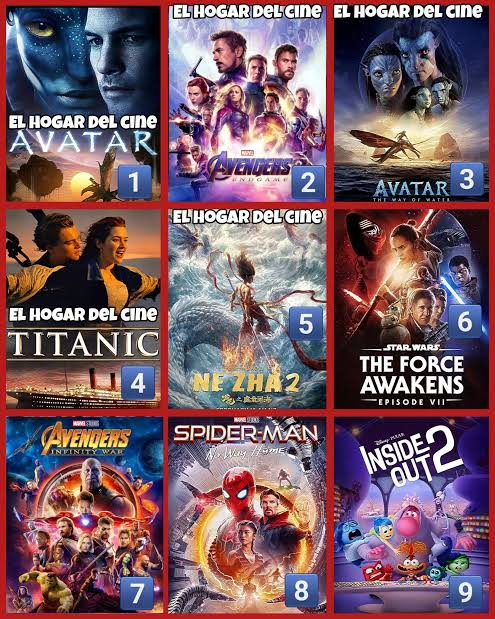
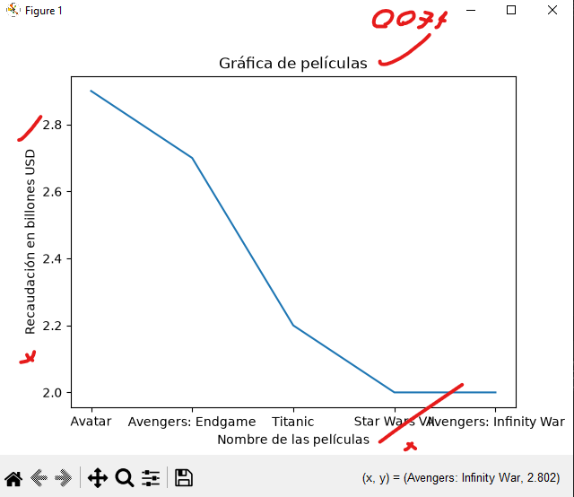
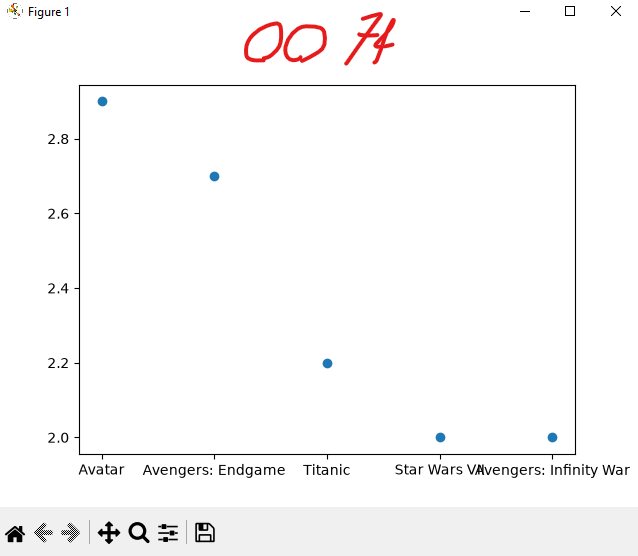
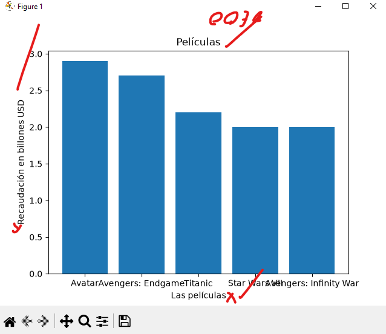
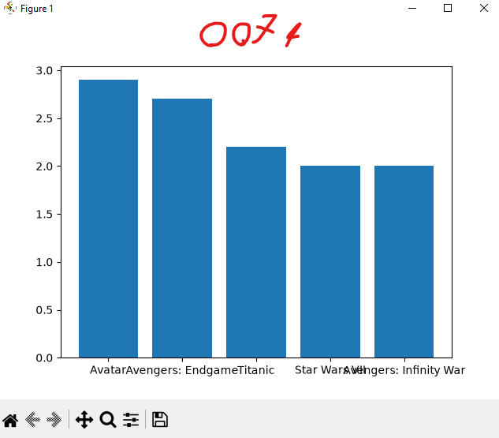
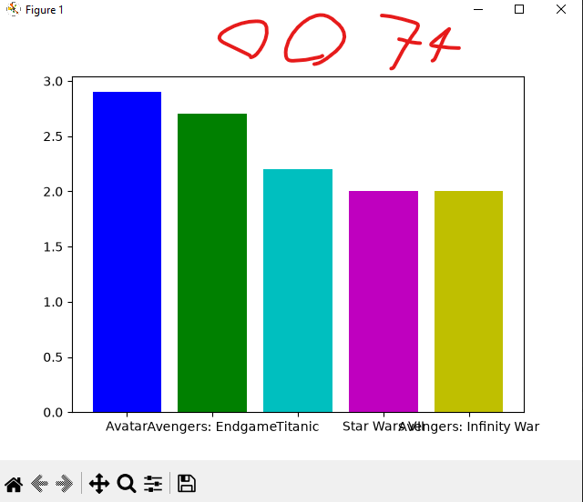
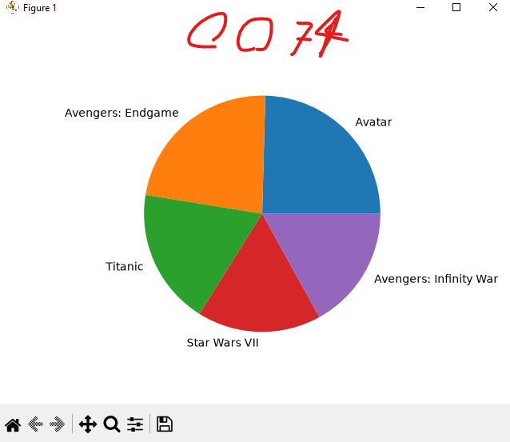

## Datafram o marco de datos pandas

## Redes sociales a nivel mundial

## Grafica Lineal de redes sociales 

## Grafica punto de redes sociales

## Grafica de barras de redes sociales

## Grafica de barras  del  mas grande al mas chico descendente (Del chivas al america)

## Coloreando la grafica

## Grafica de pastel o pie
